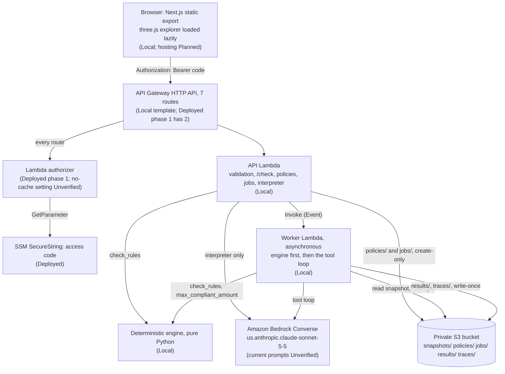
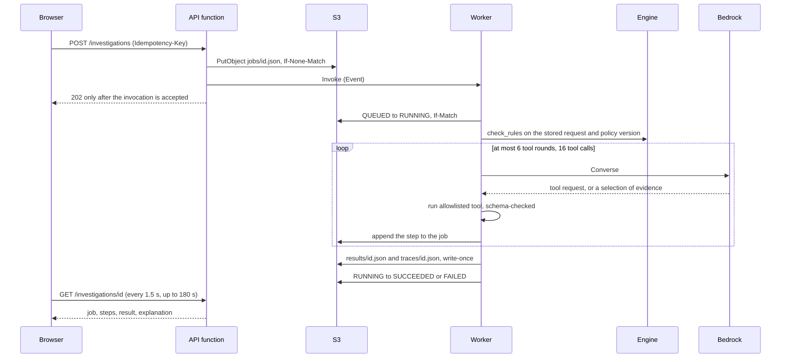

# Architecture

Technical document for Before You Buy. Fictional simulation: no advice, no
recommendation, no forecast, no trade.

**Candidate described:** local branch `integration/rc` at `deec650`, plus fixes in progress.

Every element carries one of these marks:

- **Local**: code in the candidate, with its path, exercised by local tests
  on fakes or emulations of AWS. Not deployed.
- **Deployed (phase 1)**: running in stack `before-you-buy` (`us-east-1`), as
  recorded in `infra/evidence/milestone2.md` (collected 2026-11-14 23:14 UTC
  to 2026-11-15 00:29 UTC). This is the earlier code: two routes, a
  placeholder calculation. It is not the candidate.
- **Unverified**: never observed. This covers everything the candidate would
  do in AWS: the new template in CloudFormation, API Gateway, IAM, real S3,
  Lambda timing, and the real model with the current prompts.
- **Planned**: not built.

Local results quoted as "coordinator's run" are the integration coordinator's
runs on the candidate with the real data, 2026-11-14/15.

## 1. Components

| Component | Responsibility | Status |
| --- | --- | --- |
| Interface | Six stages as one workflow; statuses with a word and an icon; no financial arithmetic of its own; fixtures mode with a persistent "Test data — fixtures" label; 3D exposure explorer with a flat chart and table as fallback | Local (`frontend/src/`). Coordinator's run: typecheck, lint, 471 unit tests, build, 25 browser tests. Hosting: Planned |
| API Gateway HTTP API | TLS endpoint, CORS preflight, throttling (20 rps / burst 40; investigation create and challenge 5 rps / burst 10), access log without headers | Template: Local (`infra/template.yaml`, asserted by `backend/tests/service/test_service_template.py`). Deployed (phase 1) with two routes |
| Authorizer | Compares the bearer code with an SSM SecureString in constant time; fails closed | Code Local and Deployed (phase 1) (`backend/api/authorizer.py`). `ReauthorizeEvery: 0` with a 30 s function cache: Unverified |
| API function | The seven routes of `contracts/api.md`: portfolio, interpret, confirm, check, create investigation, read investigation, challenge | Local (`backend/api/handler.py`) |
| Worker function | Claims the job, runs the engine on the stored request, runs the bounded tool loop, writes result and trace | Local (`backend/worker/investigation.py`, `backend/agents/`) |
| Interpreter | Turns the user's words into a draft; called by the API function for `POST /rules/interpret` and a `CLARIFY_PREFERENCE` challenge | Local on a scripted model (`backend/agents/interpreter.py`). Real model: Unverified |
| Engine | `check_rules`, `simulate_change`, `compute_exposure`, `replay_period`, `max_compliant_amount`; no I/O, no model, no clock | Local (`backend/engine/`; version in `backend/engine/version.py`) |
| Data snapshot | Holdings, prices, registries and the three scenarios under `snapshots/<id>/`, read-only for both functions | Local (`scripts/build_snapshot.py`, `backend/common/data.py`). Not uploaded |
| Stores | Jobs and policy versions as S3 objects with conditional writes; no database, no queue | Jobs: Deployed (phase 1). Policies: Local (`backend/common/policies.py`) |
| Contracts | JSON Schemas, semantics, API contract, engine cases, API examples, validators, TypeScript types | Local (`contracts/`) |

## 2. Request path: `POST /check`

Deterministic and bounded: no model, nothing stored (`contracts/api.md`
section 5). Local.

1. The browser sends the purchase request and either a stored policy version
   (`draft_rules: null`) or draft rules (a preview).
2. The API function validates the body. A percentage string such as `"25%"`,
   a NaN or an infinity is a 400.
3. It loads the validated snapshot (cached per container) and calls
   `check_rules` once.
4. The answer is a complete `check_result`: execution status, feasibility,
   policy consistency, one result per rule, starting-portfolio findings, data
   coverage, the scenario replay, the maximum compliant weight, chart rows,
   evidence records, summary and disclosures.

A preview evaluates exactly the draft rules, returns `preview: true` with a
null policy version, and never changes the stored policy. A request the engine
refuses is a 200 with `execution.status: "INVALID_REQUEST"` and no rule
result.

The 5 s budget is checked after the calculation: a late result is refused, a
running calculation is not interrupted. Locally a check on the real data takes
about 60 ms plus about 35 ms of input guards; a cold start also loads and
validates the 1.4 MB snapshot, about 0.3 s locally and not measured in Lambda
(`infra/README.md`).

## 3. Request path: an investigation

Lifecycle: `QUEUED -> RUNNING -> SUCCEEDED | FAILED`.

| Rule | How it is enforced | Status |
| --- | --- | --- |
| Store before dispatch; 202 only after the invocation is accepted | Conditional `PutObject`, then `Invoke`; a failed dispatch marks the job `FAILED / WORKER_INVOCATION_FAILED` and answers 503 | Local; the mechanism is Deployed (phase 1) |
| Idempotency | Same key and same body returns the same job; another body is a 409. A replay of a job still `QUEUED` may invoke the worker again to recover a lost invocation; a delivery for a claimed or terminal job does nothing (`contracts/api.md` section 6) | Local |
| Duplicate delivery | The worker claims the job by compare-and-swap; a second delivery returns without a model call | Local; observed live in phase 1 |
| The result is the engine's | The worker runs the engine on the stored request before and independently of any model call | Local |
| Model unavailable | The job succeeds with the same checks; every statement is a template; `agent.mode` is `DETERMINISTIC_FALLBACK` | Local, including in the browser run (`acceptance/fullstack/`) |
| Deadline | `deadline_at` = creation + 150 s. `GET` turns an overdue job into `FAILED / DEADLINE_EXCEEDED` and stores that. The page polls for 180 s | Local, by moving the clock; never waited out in real time |
| Write-once results and policy versions | Code refuses to change a terminal job; IAM allows `results/`, `traces/` and `policies/` only with `If-None-Match`, job documents only with a condition | Local; the new IAM statements are Unverified |
| Bounds | 6 tool rounds, 16 tool calls, 4,096 output tokens per call, worker reserved concurrency 5, Lambda timeout 160 s; interpreter deadline 20 s, 2,048 output tokens | Local (`backend/common/config.py`, `infra/template.yaml`) |
| Expiry | `GET` answers 410 after `expires_at` (creation + 24 h). Job documents and traces are deleted after 3 days by a bucket rule; results and policies are not deleted | Local |

Failure codes of a job: `DEADLINE_EXCEEDED`, `WORKER_INVOCATION_FAILED`,
`WORKER_ERROR`, `ENGINE_ERROR`, `DATA_UNAVAILABLE`. A model problem is a
fallback, not a failure.

Other routes, all Local: `GET /portfolios/{persona_id}` serves the scenario
from the snapshot; `POST /rules/confirm` writes a new policy version;
`POST /investigations/{id}/challenge` stores an unverified correction
(`CORRECT_FACT`), returns a new draft (`CLARIFY_PREFERENCE`), or creates a new
policy version and a child investigation (`CHANGE_RULE`).

## 4. Trust boundaries

| Zone | Trusted for | Not trusted for | Control |
| --- | --- | --- | --- |
| Browser | Displaying what the API returns | Any verdict, threshold provenance, financial arithmetic, holding a secret in the bundle | Verdicts and stored rules are written server-side. The browser run compares every displayed figure with the API response (`acceptance/fullstack/README.md`). The access code is typed at runtime and kept in `sessionStorage` |
| API function | Validation, `/check`, policy and job creation, serving stored state | Writing snapshots, results or traces; changing a stored policy version | Its role can create `policies/*` and `jobs/*` objects only conditionally and can read `snapshots/*`. It may call Bedrock for the interpreter only through the one inference profile (`infra/template.yaml`) |
| Worker | Running the engine and tools, writing the result | Overwriting a terminal job, writing a policy, creating a job | Conditional writes enforced by IAM; no write on `policies/` |
| Model | Choosing which allowlisted tools to call; selecting evidence records; marking spans of the user's text | Producing or changing a number, a status, a rule, a policy, or any sentence shown to the user | Section 5 |
| User text and source text | Being data | Being instructions | Wrapped as `untrusted_text` before the model sees them (`backend/agents/tools.py`). Injected-instruction probes left the calculation unchanged in phase 1, 6 of 6 (`infra/evidence/milestone2.md` section 14); the local browser run repeats this with a hostile scripted model |
| Data snapshot | Facts with a source, a date and a hash | Being complete or historical | Validated when built and when loaded; interval semantics for what is missing; read-only for both functions |

## 5. What the model may and may not do

| Enforcement | Status |
| --- | --- |
| A tool call runs only if its name is on the allowlist and its arguments pass that tool's schema; anything else is recorded as rejected and not executed (`backend/agents/tools.py`) | Local |
| The engine result does not depend on the model: the worker computes it from the stored request and policy version | Local |
| **No sentence written by the model is returned.** Decisive sentences are the engine's templates. The model's final answer may only list pairs of a template id from a closed set and an evidence id of the result; the server writes the sentence from the record. Raw model output is kept only in the private trace (`backend/agents/explain.py`) | Local |
| Steps shown to the user are tool events with template summaries, never model reasoning | Local. **Open: validation finding F-20 (HIGH), model-chosen strings in public tool steps; fix in progress** |
| The interpreter's model output has no numeric member and no free text that reaches the client: it marks spans, which must be found in the user's text, and picks codes from closed lists. A threshold is read by the server from the user's own words, only as a single percentage in the same sentence; otherwise the user is asked (`backend/agents/interpreter.py`) | Local on a scripted model |
| Unusable interpreter output is retried once, then answered 502; a timeout is 504. Nothing is stored and no policy is read or written | Local |
| The interpreter and the investigator cannot confirm or alter a policy: only `POST /rules/confirm` and a `CHANGE_RULE` challenge do, with the number the user sent | Local |

Runtime model: `us.anthropic.claude-sonnet-5-5` on Amazon Bedrock, a stack
parameter. Prompt versions `investigator-4` and `interpreter-3`
(`backend/agents/prompts.py`) have never been sent to the real model:
Unverified. The development model (Claude Fable 5.2 in Claude Code) is not
used by the application.

## 6. Results the engine produces

Local (`backend/engine/`); normative text in `contracts/SEMANTICS.md`.

- **Units.** Portfolio fractions (10% = 0.10), tolerance 1e-9; equality with a
  limit passes. Every number is finite: NaN and infinities are rejected by the
  validators and, independently, by the engine.
- **Intervals.** For each fund, known exposure is `fund weight x reported
  issuer weight`; the part of the fund no file reports is possible extra
  exposure to any issuer. A maximum rule is PASS when the upper bound is
  within the limit, FAIL when the lower bound is above it, otherwise UNKNOWN.
  A fund without a holdings file is entirely unknown, never zero.
- **Separate sections.** Execution status, feasibility (cash), policy
  consistency, rule results, starting-portfolio findings, data coverage,
  scenario replay, goal context. There is no overall "compliant" flag.
- **Starting-portfolio findings.** A breach that exists before the purchase is
  reported apart from what the purchase adds.
- **2022 replay.** Buy and hold from the last price of 2021 to the last price
  of 2022, cash at 0%, USD converted to CAD with the latest rate on or before
  each date. The budget is checked against the loss at the end of the period;
  the deepest fall is context only.
- **Maximum compliant weight.** A closed form (every bound is linear in the
  target weight), then the same evaluator re-run at the result. Withheld when
  no target is proven to pass.

Outcomes on the real data are in `docs/WORKFLOWS.md`.

## 7. Evidence model

Every number shown is backed by a record in `result.evidence`
(`contracts/schemas/evidence_record.schema.json`):

| Field | Meaning |
| --- | --- |
| `evidence_id` | Unique within a result; every id cited elsewhere in the result exists in it |
| `label` | `FACT` (from a cited source, or a threshold the user stated and confirmed), `FICTIONAL_SCENARIO`, `ASSUMPTION`, `CALCULATION` |
| `metric_id`, `value`, `unit`, `currency` | What was measured |
| `subject`, `period` | The instrument, issuer or portfolio state, and the date or range |
| `source_ids` | Records in the source registry |
| `assumptions` | Modelling choices that apply |
| `derived_from`, `formula` | The calculation path: the records a calculation used, and the formula printed with the numbers |
| `calculation_version`, `policy_version` | Engine version and the policy version evaluated (null in a preview) |

Example on the real data (`backend/engine/evidence/robert_max_compliant.md`,
generated with an earlier engine version; the coordinator's run gives the same
boundary): the record `ev-max-final` lists in `derived_from` both thresholds,
NVIDIA's look-through records and bounds, the unattributed fund weight, the
starting scenario return, NVDA's scenario return, starting cash and starting
weight; the engine tests recompute the boundary from those records alone.

A disputed fact is stored as an `UNVERIFIED` proposed correction next to the
record. It changes no calculation (Local; `acceptance/fullstack/`).

Known gap: the API example fixture `investigation_mateo_succeeded` shows
numbers that no record of its `evidence[]` backs (finding L1, open, a fixture
defect; `acceptance/mateo/FINDINGS.md`).

## 8. Policy versions

`contracts/schemas/policy.schema.json`: `policy_id`, `version`,
`parent_version`, `rules`, `objectives`, `change_note`, `content_hash`.

- A rule is `PROPOSED`, `CONFIRMED` or `SUPERSEDED`. Only confirmed rules with
  a number are evaluated.
- A version is immutable: it is created with `If-None-Match: *` and never
  rewritten (`backend/common/policies.py`). Changing a rule creates version
  n+1 in which the old rule stays as `SUPERSEDED` and its replacement follows
  it. Earlier versions and their reports stay retrievable.
- The server writes the stored rule and its provenance; the client does not.

Status: Local. In the browser run on the real data, Robert's version 1 report
is still retrievable and unchanged after version 2 is created (coordinator's
run). Policy versions do not expire.

## 9. Data snapshot identity

- A snapshot is a directory of nine files (a manifest plus eight) built by
  `scripts/build_snapshot.py` from `data/processed/` and
  `contracts/scenarios/`. Its id, `snap-<valuation date>-<12 hex>`, is derived
  from the SHA-256 of every file: other data, other id.
- For the data of 2026-11-14 the script printed
  `snap-2026-11-12-3390e023b308` (`scripts/deploy.md` section 3b).
- A snapshot is never modified in place. The id in use is the stack parameter
  `DataSnapshotId`; new data is a new id and a parameter change.
- Both functions verify the manifest id, the hash of every file, strict JSON,
  the contract validators and coverage consistency before serving anything; a
  snapshot that fails serves nothing.
- Every investigation records the id it used in the job's internal part, the
  stored result's inputs, the trace and the logs. The id is **not** a member
  of the result or job documents that `GET` returns (schema 1.0.0 is frozen).
- Holdings: one snapshot per fund, holdings date 2026-11-12. Valuation date
  2026-11-12; reporting currency CAD.

Status: Local. No snapshot has been uploaded.

## 10. Security model and its disclosed limits

| Control | Status |
| --- | --- |
| One shared bearer access code, checked by the authorizer against an SSM SecureString; typed at runtime, kept in `sessionStorage`, never in the bundle or the repository | Deployed (phase 1) |
| Private bucket: Block Public Access, SSE-S3, TLS-only bucket policy | Deployed (phase 1) (`infra/evidence/milestone2.md` section 8) |
| One IAM role per function, inline policies, no `*` action and no `Resource: "*"` | Phase-1 roles Deployed and simulated. The candidate's added statements (policies, snapshots, the interpreter's Bedrock grant on the API role) are Unverified, and the validator's static review of the API role is being re-judged |
| CORS: one exact origin, no default, guard against `*` in the deploy snippet | Local (`infra/template.yaml`, `scripts/mcp/02_deploy.py`). The deployed stack still allows `*` |
| A rotated code is refused within 30 s | Local; Unverified in AWS (`scripts/deploy.md` section 7). On the deployed stack the worst case is about 6 minutes |
| Security headers on the hosted site | Planned (`docs/DEPLOYMENT.md`) |

Limits, stated plainly:

- The access code is demonstration-grade. It is not user identity: everyone
  who has it sees the same fictional data and each other's investigations if
  they know an id. Acceptable only because all data is fictional.
- CORS is not authentication.
- No alarm, dashboard, tracing or dead-letter queue.
- The account id and the API host appear in tracked files. They are not
  credentials.
- The account is a workshop account deleted at the end of 2026-11-16.

## 11. Validation

| What | Result | Source |
| --- | --- | --- |
| Backend, engine and contract tests | 1685 passed, 9 skipped, in a checkout without the git-ignored data | our run, README section 6 |
| Backend, contracts and Mateo suites with the real data | 1883 passed, 1 known test under re-judgement | coordinator's run |
| Mateo acceptance | Statuses, bounds, findings and coverage equal an independent recomputation on the synthetic and the real data; two low findings open (L1, B1) | `acceptance/mateo/FINDINGS.md` |
| Full-stack browser run on the real data | 30 of 31; the one failure expects a model-written sentence the backend no longer returns. Frontend findings F-01 to F-08, none blocking | coordinator's run; `acceptance/fullstack/FINDINGS.md` |
| Independent validation | Third pass on `d223714`: 1268 passed, 6 strict expected failures; "go with disclosed limits", conditional on fixing F-20. Fourth pass in progress | reported by the coordinator; criteria in `validation/ACCEPTANCE.md` |
| Phase-1 deployment | Real requests recorded; what it does not prove is in section 16 of the evidence file | `infra/evidence/milestone2.md` |
| The candidate in AWS | **Nothing.** The manual and live checks M1 to M3 and L1 to L6 of `validation/ACCEPTANCE.md` have not been run | |
