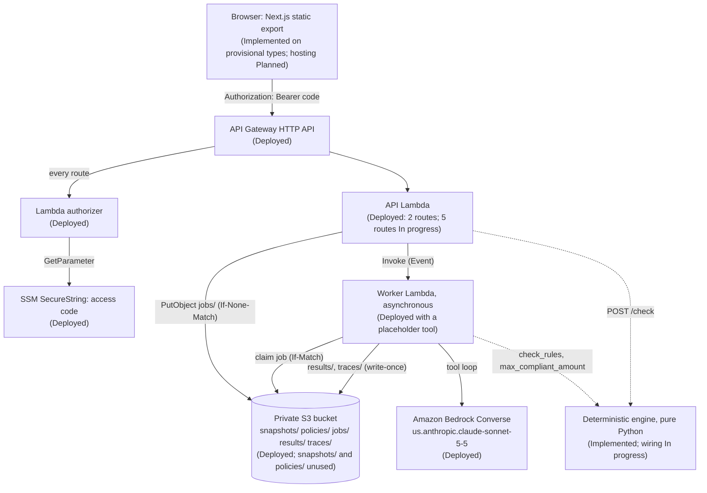
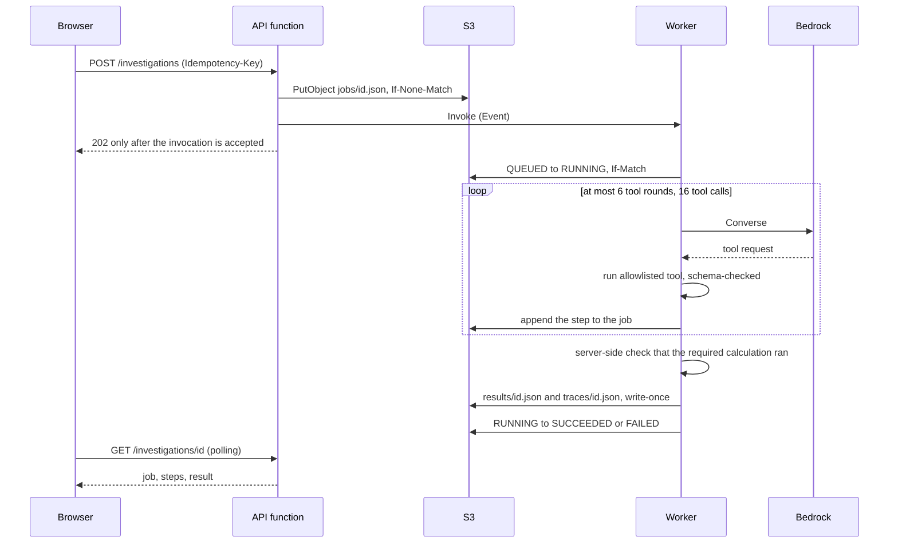

# Architecture

Technical document for Before You Buy at commit `d36e41f` (2026-11-15 UTC).
Fictional simulation: no advice, no recommendation, no forecast, no trade.

Every element carries one of these marks:

- **Implemented**: code in this commit, with its path. Tested unless stated.
- **Deployed**: running in stack `before-you-buy` (`us-east-1`), as recorded
  in `infra/evidence/milestone2.md` (collected 2026-11-14 23:14 UTC to
  2026-11-15 00:29 UTC). Not re-checked for this document.
- **Specified**: defined in `contracts/`, with fixtures, but no service code
  in this commit.
- **In progress**: reported by the lead on 2026-11-14 as being built
  elsewhere; not in this commit, not verified here.
- **Planned**: neither built nor in progress.

## 1. Components

Dotted lines are not in this commit.

| Component | Responsibility | Status |
| --- | --- | --- |
| Interface | Six stages as one workflow; shows statuses with a word and an icon; fixtures mode with a persistent "Test data — fixtures" label | Implemented on provisional types (`frontend/src/`, `frontend/src/lib/provisional-types.ts`). Contract types and a 3D exposure explorer: In progress. Hosting: Planned (`docs/DEPLOYMENT.md`) |
| API Gateway HTTP API | TLS endpoint, CORS preflight, throttling (20 rps / burst 40; `POST /investigations` 5 rps / burst 10), access log without headers | Deployed (`infra/template.yaml`; evidence section 14) |
| Authorizer | Compares the bearer code with an SSM SecureString in constant time | Implemented (`backend/api/authorizer.py`), Deployed (evidence sections 3, 6) |
| API function | Validates, stores the job, dispatches the worker, serves job state, enforces the deadline on read | Implemented (`backend/api/handler.py`), Deployed for `POST /investigations` and `GET /investigations/{id}` with pre-contract shapes. The other five routes of `contracts/api.md`: Specified; In progress |
| Worker function | Claims the job, runs the bounded tool loop, enforces the required calculation, writes result and trace | Implemented (`backend/worker/investigation.py`, `backend/agents/`), Deployed with one placeholder tool. Real engine in the worker: In progress |
| Engine | `check_rules`, `simulate_change`, `compute_exposure`, `replay_period`, `max_compliant_amount`; no I/O, no model, no clock | Implemented (`backend/engine/`, version `byb-engine-1.0.1` in `backend/engine/version.py`). Not deployed |
| Contracts | 19 JSON Schemas, semantics, API contract, 26 engine cases, 24 API examples, validators, TypeScript types | Implemented (`contracts/`) |
| Data pipeline | Acquire, normalize, audit, quality-check | Implemented (`data/scripts/`); results recorded in `docs/data-sources.md` |
| Job store | S3 conditional writes; no database, no queue | Implemented (`backend/common/jobs.py`), Deployed |

## 2. Request path: `POST /check`

Specified in `contracts/api.md` section 5. **The route does not exist in the
service at this commit** (`backend/api/handler.py` handles only the two
investigation routes); it is In progress. The calculation behind it is
Implemented and tested.

1. The browser sends the purchase request and either a stored policy version
   (`draft_rules: null`) or draft rules (a preview).
2. The service validates the body against the schema. A percentage string such
   as `"25%"` is a 400.
3. The service calls `check_rules` once (`backend/engine/check.py`). There is
   no model call and nothing is stored. Budget 5 s.
4. The answer is a complete `check_result`: execution status, feasibility,
   policy consistency, one result per rule, starting-portfolio findings, data
   coverage, the scenario replay, the maximum compliant weight, chart rows,
   evidence records, summary and disclosures.

A preview evaluates exactly the draft rules, returns `preview: true` with a
null policy version, and never changes the stored policy. A request the engine
refuses (for example a target below the current weight) is a 200 with
`execution.status: "INVALID_REQUEST"` and no rule result.

## 3. Request path: an investigation

Lifecycle: `QUEUED -> RUNNING -> SUCCEEDED | FAILED`. Implemented and Deployed
as described in `infra/README.md` "Lifecycle rules"; the wire shapes are those
of phase 1, not yet of `contracts/api.md` sections 6 and 7.

| Rule | How it is enforced | Status |
| --- | --- | --- |
| Store before dispatch; 202 only after the invocation is accepted | Conditional `PutObject`, then `Invoke`; a failed dispatch marks the job `FAILED` and answers 503 | Implemented, Deployed. Live: only the success path (evidence section 16) |
| Idempotency | Job id = `inv_` + 32 hex characters of a SHA-256 over the key; creation uses `If-None-Match: *`; same key and same body returns the same job; another body is a 409 | Implemented, Deployed (smoke-run checks, `scripts/deploy.md` section 6) |
| Duplicate delivery | The worker claims the job by compare-and-swap; a second delivery finds it not `QUEUED` and returns | Implemented, Deployed, observed live (`infra/README.md` "Decisions") |
| Deadline | `deadline_at` = creation + 150 s. The worker stops 5 s before it. `GET` turns an overdue job into `FAILED / DEADLINE_EXCEEDED` and stores that | Implemented, Deployed. Expiry not provoked in AWS (evidence section 16) |
| Write-once results | Code refuses to change a terminal job; IAM allows `results/` and `traces/` only with `If-None-Match`, job documents only with `If-Match` or `If-None-Match` | Implemented, Deployed; 36 IAM simulations (evidence section 9) |
| Bounds | 6 tool rounds, 16 tool calls, 4,096 output tokens per call, 4 attempts per model call, worker reserved concurrency 5, Lambda timeout 160 s | Implemented (`backend/agents/loop.py`, `backend/common/config.py`), Deployed |
| Client polling deadline longer than the job deadline | Contract: 180 s. The interface at this commit uses 120 s (`frontend/src/lib/config.ts`) | Specified; the frontend value is a known defect |
| Job expiry, 410 after `expires_at` | | Specified; not implemented (`infra/README.md` "Limitations") |

Not in the service at this commit, Specified in `contracts/api.md` and In
progress: `GET /portfolios/{persona_id}`, `POST /rules/interpret`,
`POST /rules/confirm`, `POST /investigations/{id}/challenge`, the contract's
job document, the deterministic fallback when the model is unavailable
(`agent.mode: DETERMINISTIC_FALLBACK`; in phase 1 a model failure fails the
job), and storing policy versions (no role may write to `policies/` in the
deployed stack).

## 4. Trust boundaries

| Zone | Trusted for | Not trusted for | Control |
| --- | --- | --- | --- |
| Browser | Displaying what the API returns | Any verdict, threshold provenance, financial arithmetic, holding a secret in the bundle | Verdicts and stored rules are written server-side. The access code is typed at runtime and kept in `sessionStorage` (`frontend/src/lib/access-code.ts`). Moving the remaining arithmetic out of the browser is In progress (`docs/PLAN.md` P9) |
| API | Validation, job creation, serving stored state | Calling the model on the investigation path | Separate IAM role: no Bedrock permission, no read of `traces/` (`infra/README.md` "IAM") |
| Worker | Running tools, writing the result | Overwriting a terminal job, writing unconditionally | Conditional writes enforced by IAM |
| Model | Choosing which allowlisted tools to call, wording an explanation | Producing or changing a number, a status, a rule or a policy | Section 5 |
| User text and source text | Being data | Being instructions | The stored request is wrapped as untrusted data (`backend/agents/prompts.py`); injected-instruction probes did not change the calculation, 6 of 6 (evidence section 14). Wrapping third-party text returned by tools the same way is In progress (`docs/PLAN.md` P9) |
| Data snapshot | Facts with a source, a date and a hash | Being complete or historical | Interval semantics (section 6); the snapshot is read-only for both functions (no role may write `snapshots/`) |

## 5. What the model may and may not do

The model may: read the stored request, call tools from an allowlist, and
write explanatory text. It may not: decide a status, change a number, confirm
or alter a policy, choose a security, or skip a rule.

| Enforcement | Status |
| --- | --- |
| A tool call runs only if its name is registered and its arguments pass that tool's schema; anything else is recorded as `REJECTED` and not executed (`backend/agents/tools.py`) | Implemented, Deployed. Rejection is unit-tested; an unknown tool was not provoked live |
| After the loop the worker checks that the required calculation ran with the stored request's arguments and runs it itself if not; the result is built from that run (`backend/worker/investigation.py`) | Implemented, Deployed. The server-run path never occurred live: in all 32 recorded investigations the model called the tool correctly (evidence section 16) |
| The result is the engine's output; `check_rules` and `max_compliant_amount` are run by the server whatever the model did (`initiated_by: "SERVER"` in `contracts/fixtures/api/investigation_robert_succeeded.json`) | Specified; In progress. In the deployed phase the single tool is a placeholder and no verdict is produced |
| Steps shown to the user are tool events with template summaries, never model reasoning | Implemented, Deployed |
| A model-written sentence is kept only if it cites evidence records for the right metric, subject, unit and period; otherwise a template is used (`contracts/SEMANTICS.md` section 13) | Specified; not implemented. The deployed result says `verified_against_evidence: false` (`infra/README.md` "Limitations") |
| The interpreter never emits a number the user did not write; a system-proposed rule has a null threshold and is inactive until confirmed (`contracts/SEMANTICS.md` section 14) | Specified; In progress |

Runtime model: `us.anthropic.claude-sonnet-5-5` on Amazon Bedrock, a stack
parameter. The development model (Claude Fable 5.2 in Claude Code) is not used
by the application.

## 6. Results the engine produces

Implemented in `backend/engine/`; normative text in `contracts/SEMANTICS.md`.

- **Units.** Portfolio fractions (10% = 0.10), tolerance 1e-9; equality with a
  limit passes.
- **Intervals.** For each fund, known exposure is `fund weight x reported
  issuer weight`; the part of the fund no file reports is possible extra
  exposure to any issuer. A maximum rule is PASS when the upper bound is
  within the limit, FAIL when the lower bound is above it, otherwise UNKNOWN.
  A fund without a holdings file is entirely unknown, never zero.
- **Separate sections.** Execution status, feasibility (cash), policy
  consistency, rule results, starting-portfolio findings, data coverage,
  scenario replay, goal context. There is no overall "compliant" flag.
- **Starting-portfolio findings.** A breach that exists before the purchase is
  reported apart from what the purchase adds.
- **2022 replay.** Buy and hold from the last price of 2021 to the last price
  of 2022, cash at 0%, USD converted to CAD with the latest rate on or before
  each date. The budget is checked against the loss at the end of the period;
  the deepest fall is context only.
- **Maximum compliant weight.** A closed form (every bound is linear in the
  target weight), then the same evaluator re-run at the result. Withheld when
  no target is proven to pass. A rounding fix (round down instead of to
  nearest; effect at most 5e-10) is In progress.

## 7. Evidence model

Every number shown is backed by a record in `result.evidence`
(`contracts/schemas/evidence_record.schema.json`):

| Field | Meaning |
| --- | --- |
| `evidence_id` | Unique within a result; every id cited elsewhere in the result exists in it |
| `label` | `FACT` (from a cited source, or a threshold the user stated and confirmed), `FICTIONAL_SCENARIO`, `ASSUMPTION`, `CALCULATION` |
| `metric_id`, `value`, `unit`, `currency` | What was measured |
| `subject`, `period` | The instrument, issuer or portfolio state, and the date or range |
| `source_ids` | Records in the source registry (`data/processed/sources.json`) |
| `assumptions` | Modelling choices that apply |
| `derived_from`, `formula` | The calculation path: the records a calculation used, and the formula printed with the numbers |
| `calculation_version`, `policy_version` | Engine version and the policy version evaluated (null in a preview) |

Example on the real data (Implemented; `backend/engine/evidence/robert_max_compliant.md`):
the record `ev-max-final` lists eleven records in `derived_from` (both
thresholds, NVIDIA's look-through records and bounds, the unattributed fund
weight, the starting scenario return, NVDA's scenario return, starting cash and
starting weight), and the engine tests recompute the boundary from those
records alone.

A disputed fact is stored as an `UNVERIFIED` proposed correction next to the
record. It changes no calculation (`contracts/api.md` section 8; Specified, In
progress).

## 8. Policy versions

`contracts/schemas/policy.schema.json`: `policy_id`, `version`,
`parent_version`, `rules`, `objectives`, `change_note`, `content_hash`.

- A rule is `PROPOSED`, `CONFIRMED` or `SUPERSEDED`. Only confirmed rules with
  a number are evaluated.
- A version is immutable. Changing a rule creates version n+1 in which the old
  rule stays as `SUPERSEDED` and its replacement follows it. Earlier versions
  and their reports stay retrievable.
- The server writes the stored rule and its provenance; the client does not.

Status: the schema, the validators and the engine's handling of superseded
rules are Implemented (fixture R2). Creating and storing versions through
`POST /rules/confirm` and a `CHANGE_RULE` challenge is Specified and In
progress.

## 9. Data snapshot identity

- Holdings: one snapshot per fund, holdings date 2026-11-12, source ids
  `ssga_spy_holdings_2026-11-14` and `ishares_xiu_holdings_2026-11-14`
  (`backend/engine/evidence/robert_max_compliant.md` section A). Raw-file
  SHA-256 values are in `data/manifests/raw_files_manifest.json`.
- The build is deterministic: two consecutive builds were byte-identical
  (`docs/data-sources.md` section 1).
- Valuation date 2026-11-12; reporting currency CAD.
- A result carries `valuation_date`, `calculation_version`, and per fund the
  `holdings_date`, `coverage_fraction` and `source_id` (`data_coverage`).
  Schema 1.0.0 has no single snapshot identifier or hash in a result.
- Loading the snapshot into `snapshots/` in S3 and reading it in the worker:
  In progress. No upload step exists in this commit (`docs/DEPLOYMENT.md`).

## 10. Security model and its disclosed limits

| Control | Status |
| --- | --- |
| One shared bearer access code, checked by the authorizer against an SSM SecureString; typed at runtime, kept in `sessionStorage`, never in the bundle or the repository | Implemented, Deployed |
| Private bucket: Block Public Access, SSE-S3, TLS-only bucket policy | Deployed (evidence section 8) |
| One IAM role per function, inline policies, no `*` action and no `Resource: "*"` | Deployed (evidence section 9) |
| No secret in logs, objects or outputs | Checked (evidence section 10) |
| CORS allow-list of one origin; security headers on the hosted site | Planned (`docs/DEPLOYMENT.md`). The allowed origin is `*` today |

Limits, stated plainly:

- The access code is demonstration-grade. It is not user identity: everyone
  who has it sees the same fictional data, and there is no isolation between
  users. This is acceptable only because all data is fictional.
- A rotated code is accepted within 60 s; the old one can be accepted for up
  to 300 s (`scripts/deploy.md` section 7).
- CORS is not authentication.
- No alarm, dashboard, tracing or dead-letter queue (`infra/README.md`
  "Limitations").
- The account is a workshop account deleted at the end of 2026-11-16.

## 11. Validation

- Python tests at this commit: 1083 passed, 3 skipped (the real-data engine
  tests, which need git-ignored files). Command in the README, section 6.
- Engine fixtures: 26 hand-calculated cases; a separate plain implementation
  re-derives every expected number and 35 deliberate mutations are caught
  (`contracts/fixtures/engine/HAND_CALCS.md`).
- Deployed slice: `infra/evidence/milestone2.md`; what it does not prove is in
  its section 16.
- Independent validation: In progress; nothing in this commit.
