# ETHOS: AWS architecture

ETHOS (repository and stack name: Before You Buy) checks whether a simulated purchase respects rules the investor
confirmed, and shows the evidence. Fictional simulation: no advice, no recommendation, no forecast, no trade.

State described: the code freeze of 2026-11-15 22:52 EST (`infra/evidence/release-2026-11-15-freeze.md`).
Account region: `us-east-1`. The AWS account is temporary and is deleted at the end of 2026-11-16.

Editable source: [`aws-architecture.mmd`](aws-architecture.mmd) (Mermaid). The SVG is rendered from it.

## How to read the diagram

1. The browser loads the static site from Amplify Hosting.
2. Every API call goes to one API Gateway HTTP API and carries the access code in the `Authorization` header.
3. API Gateway calls the Lambda authorizer on every route. The authorizer reads the code from an SSM SecureString
   parameter and answers allow or deny. Nothing is cached at the gateway.
4. Authorized requests reach the API function.
5. For an investigation, the API function validates the request, stores a job document in S3 with a conditional
   write, and
6. invokes the worker function asynchronously, then answers `202` with the job id.
7. The worker first runs the deterministic engine, which computes the verdict and every figure. Only then does the
   investigator agent call Amazon Bedrock (Converse API with tool use) to look at that result through read-only tools.
8. The worker stores the result and a trace of the tool calls in S3.
9. The browser polls `GET /investigations/{id}` until the job is `SUCCEEDED` or `FAILED`.

The dotted line from the API function to Bedrock is the rule interpreter: it turns the investor's wording into draft
rules or a clarification question. It never sets a number and never confirms a rule.

## Services, what each one does here, and why it was chosen

| Service | Role in this project | Why |
|---|---|---|
| AWS Amplify Hosting | Serves the static site (Next.js export). No repository is connected: each release uploads a zip. | Static files need no server; a manual deployment keeps the published site tied to a recorded artifact. |
| Amazon API Gateway (HTTP API) | Single entry point: 8 routes, CORS restricted to the site's origin, throttling, access log. | Managed TLS, routing and throttling in front of Lambda. |
| AWS Lambda | Three Python functions on arm64: authorizer, API, worker. The worker has reserved concurrency. | No server to run; the asynchronous worker gives investigations a longer time budget than an HTTP request. |
| AWS Systems Manager Parameter Store | One SecureString: the shared access code. | The secret stays out of code, templates and the site. |
| Amazon S3 | One private bucket: the data snapshot, policy versions, job state, results and traces. | The job and policy stores need only conditional writes, which S3 provides; no database or queue to operate. |
| Amazon Bedrock | Converse API, Claude Sonnet 5.5 through one cross-region inference profile. Used by the investigator (worker) and the rule interpreter (API function). | Managed model access with IAM scoped to one inference profile. |
| Amazon CloudWatch Logs | Four log groups (three functions, API access log), 7-day retention. | Operational trace of every request and job. |
| AWS CloudFormation (SAM transform) | Deploys everything above except the Amplify app and the SSM parameter. | Reviewable change sets; the template is in `infra/template.yaml`. |
| AWS IAM | One role per function, each limited to what that function does. | Least privilege, listed below. |

No other AWS service is part of the solution. In particular there is no database, no queue, no VPC, no AgentCore and
no SageMaker.

## What was verified, and how

**Read from the live account on 2026-11-15 around 22:55 EST** (read-only API calls: CloudFormation, Lambda, API
Gateway, S3, Amplify, SSM `DescribeParameters`, CloudWatch Logs; no secret value was read for this document):

- Stack `before-you-buy`: `UPDATE_COMPLETE`. Resources: 3 Lambda functions, 3 IAM roles, 1 HTTP API with 1 stage,
  1 S3 bucket with its policy, 4 log groups, 9 Lambda permissions, 1 event-invoke configuration.
- Functions: `python3.14`, `arm64`, 512 MB. Timeouts: API 25 s, worker 160 s, authorizer 5 s. Worker reserved
  concurrency: 5.
- HTTP API: the 8 routes below, each with the custom authorizer; one `REQUEST` authorizer on the `Authorization`
  header with a result TTL of 0; CORS origin = the Amplify site only; allowed headers `authorization`,
  `content-type`, `idempotency-key`; default throttling 20 requests per second, burst 40; access logging on.
- Bucket: SSE-S3 (`AES256`) by default, all four public-access blocks on, lifecycle expiry of 3 days on `jobs/` and
  `traces/`; top-level prefixes `jobs/`, `policies/`, `results/`, `snapshots/`, `traces/`.
- Amplify app: platform `WEB`, no repository, one branch `main` (production).
- SSM: one parameter of type `SecureString`.
- Log groups: retention 7 days.

**Taken from the release records, not re-checked for this document:** which code and data are deployed (backend
`lambda/byb-backend-3366f6357259c7ec.zip`, data snapshot `snap-2026-11-12-2662b7a89c03`, site = Amplify job 9 built
from `main` at `22b2d9d`), and the results of the live checks listed in the technical documentation.

**From the source only:** IAM policy contents (`infra/template.yaml`), the order "engine first, model second"
(`backend/worker/investigation.py`), and the internal behaviour of each function.

## Routes

| Route | Function | Purpose |
|---|---|---|
| `GET /portfolios/{persona_id}` | API | The fictional persona, portfolio, scenario rules and instruments. |
| `POST /rules/interpret` | API, calls Bedrock | Wording to draft rules or a clarification question. |
| `POST /rules/confirm` | API | Stores a new immutable policy version from rules the user confirmed. |
| `POST /check` | API | Instant deterministic check (preview). No model. |
| `POST /investigations` | API, then worker | Creates a job and starts it asynchronously. |
| `GET /investigations/{id}` | API | Job state, steps, result. |
| `POST /investigations/{id}/challenge` | API | Correct a fact, clarify a preference, or change a rule (new policy version, new job). |
| `POST /evidence/investigate` | API | Read-only answers about missing or partial fund holdings, for the Evidence Investigator page (`/evidence/`). Deterministic: model wording is switched off in this release, so it makes no Bedrock call. One independent question per request, no history; reads the scenario portfolio in the snapshot, not a customized one. |

The contract of each route is in `contracts/api.md`.

## Access control and permissions

- One shared access code protects every route. It is a demonstration gate, not user authentication: there are no
  user accounts and nothing is stored per user.
- IAM, from the template: the authorizer role may read that one parameter and nothing else; the API role may read
  the snapshot, read and conditionally write policies and jobs, invoke the worker function only, and call Bedrock
  through the one inference profile; the worker role may read the snapshot and policies, conditionally write jobs,
  results and traces, and call Bedrock through the same profile. No role has `s3:*`, `bedrock:*` or a `*` resource.
- The bucket is private; the site never reads S3 directly.
- The site contains the API address and no secret. The access code is typed by the visitor and kept for the browser
  tab only.

## Data in S3

| Prefix | Content | Written by | Lifetime |
|---|---|---|---|
| `snapshots/<snapshot id>/` | The dated data snapshot: instruments, fund holdings, prices and FX, controversy registry, sources, persona scenarios, manifest with hashes. | Release procedure | Kept |
| `policies/<policy id>/v<n>.json` | Policy versions. A version is never rewritten. | API function | Kept |
| `jobs/<job id>.json` | Job state and steps. | API function, worker | 3 days |
| `results/<job id>.json` | The final result of a job. | Worker | Kept (no expiry rule was observed for this prefix) |
| `traces/<job id>.json` | The trace of model and tool calls of a job. | Worker | 3 days |

## Facts not established

- IAM policies were read in the template, not in the account.
- The exact contents of the published site and of the Lambda code were not compared with the repository for this
  document; the freeze record reports that comparison.
- Whether Bedrock model invocation logging is enabled in the account was not checked.
- Costs were not measured.
